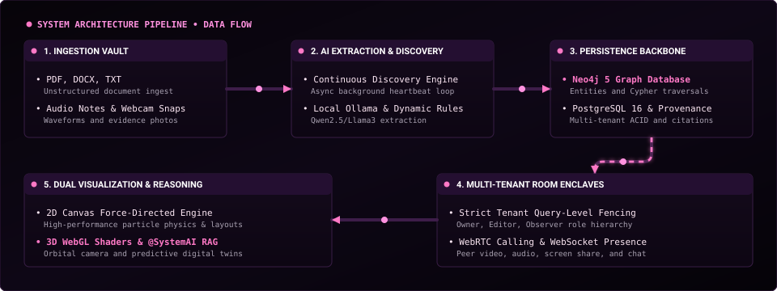
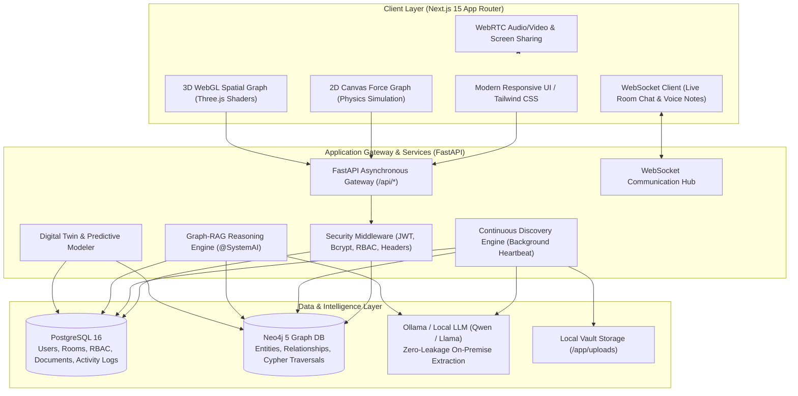
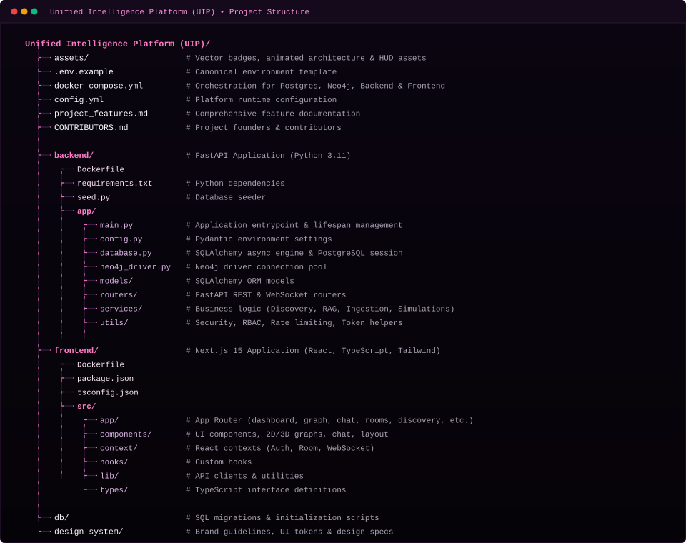
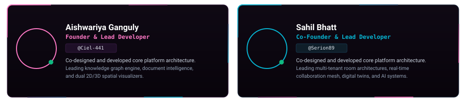

<div align="center">

  

  <br /><br />

  <p align="center">
    <a href="https://github.com/Ciel-441/UIP"></a>
    
    
    
    
    
    
    
  </p>

  <p align="center">
    <a href="#overview">Overview</a> &#8226;
    <a href="#system-architecture">System Architecture</a> &#8226;
    <a href="#key-platform-capabilities">Key Capabilities</a> &#8226;
    <a href="#project-structure">Project Structure</a> &#8226;
    <a href="#quick-start-guide">Quick Start</a> &#8226;
    <a href="#endpoints--service-map">Service Map</a> &#8226;
    <a href="#environment-configuration-reference">Configuration</a> &#8226;
    <a href="#founders--core-contributors">Founders</a>
  </p>

</div>

---

## Overview

The **Unified Intelligence Platform (UIP)** is a high-performance, enterprise-grade intelligence platform that converts unstructured multi-modal data into structured, actionable knowledge graphs. It bridges the divide between static document archives, relational records, and interactive network science.

Engineered with a **strict multi-tenant isolation model ("Rooms")**, UIP equips intelligence analysts, researchers, engineers, and domain specialists to collaborate in real-time, execute on-premise generative AI extractions, simulate forward-looking digital twin projections, and inspect interconnected data topologies through a state-of-the-art dual-engine **2D Canvas** and **3D WebGL** spatial graph visualizer.

---

## System Architecture

<div align="center">
  
</div>

<br />



---

## Key Platform Capabilities

### 1. Multi-Tenant Workspace Isolation ("Rooms")
* **Isolated Enclaves:** Workspaces represent distinct operations, investigation domains, or research projects.
* **Granular RBAC:** Built-in role hierarchy (**Owner**, **Editor**, **Observer**) enforcing granular read/write privileges.
* **Query-Level Data Fencing:** Strict tenant isolation at the query layer via SQLAlchemy filter clauses and Neo4j Cypher parameters: preventing cross-tenant data leakage.

### 2. Dual-Engine Interactive Knowledge Graph
* **2D Canvas Force-Directed Engine:** High-performance canvas layout with directional particle flows, halo glow effects, and responsive physics.
* **3D Spatial WebGL Engine:** Powered by `Three.js` and `react-force-graph-3d` featuring metallic/roughness shaders, orbital camera navigation, and dynamic 3D link physics.
* **Progressive Disclosure (Focus Mode):** Click or hover on any entity to dim unrelated clusters and highlight direct multi-hop pathways.
* **Persistent Coordinate Memory:** Interactive drag-and-drop coordinate persistence (`ui_x`, `ui_y`) saved to the database across sessions.
* **Algorithmic Presets:** Instant layout switching between Force Physics, Hierarchical Flow, Horizontal Flow, Circular, Radial, and Grid arrangements.

### 3. Document Intelligence & Continuous Ingestion
* **Multi-Format Ingestion:** Drag-and-drop vault for PDFs, Word documents (`.docx`), TXT files, and raw data dumps.
* **Continuous Discovery Engine:** Asynchronous background heartbeat service automatically parsing newly staged documents and queueing them for structured transformation.
* **Automated Entity & Relationship Extraction:** Detects entities (People, Organizations, Locations, Chemicals, Systems, Concepts) and semantic relationships (`affects`, `linked_to`, `partner_of`).
* **Dynamic Extraction Rules:** Custom user-defined extraction directives (e.g., *"Extract all marital relationships"* or *"Map chemical-plant interactions"*) overriding default AI behavior.
* **Verifiable Provenance Citations:** Nodes and edges maintain direct citation links back to source documents and page references in PostgreSQL.

### 4. Local Generative AI & Graph-RAG
* **Zero Cloud Leakage:** Fully integrated with local Ollama runtime (supporting `qwen2.5`, `llama3`, and custom quantizations).
* **`@SystemAI` In-Room Assistant:** Mention `@SystemAI` in any room to invoke graph-grounded conversational reasoning.
* **Hybrid Retrieval-Augmented Generation:** Combines vector and full-text document searches with multi-hop Neo4j Cypher traversals to supply grounded context without hallucinations.

### 5. Real-Time Collaboration & Communication
* **Live WebSocket Messaging:** Low-latency room communication with typing indicators, presence, and read states.
* **Rich Media & Attachments:** File sharing, images, and embedded document links.
* **In-Browser Voice Notes:** Audio capture widget with interactive waveform playback.
* **WebRTC Peer Calls:** Built-in video/audio calling and screen sharing overlays directly within the room interface.
* **Instant Camera Snaps:** Direct webcam capture integration for incident photos and field reports.

### 6. Digital Twins & Predictive Simulations
* **System Modeling:** Create digital counterparts of physical or logical systems (agricultural plots, supply pipelines, industrial equipment).
* **Multi-Variable Parameter Optimization:** Calculates optimal operational parameters based on graph properties and environmental conditions.
* **Timeline Projection Simulator:** Multi-variable chronological equations generating predictive time-series charts for risk and yield forecasting.

### 7. Investigations & Contradiction Detection
* **Hypothesis Testing:** Pin entities and build forensic investigation timelines.
* **Contradiction Stream:** Automatically flags opposing intelligence statements or conflicting relationship assertions across different source documents.
* **Entity Resolution Engine:** Deduplication tool that reconciles synonymous nodes and merges edges with zero orphaned relationships.

### 8. Executive Dashboard, Analytics & Reporting
* **Live Metric Counters:** Track entity counts, relationship density, document ingestion rates, and room interaction velocities.
* **Knowledge Growth Timelines:** 30-day temporal analytics illustrating the rate of intelligence accumulation.
* **Multi-Format Export Engine:** Compile structured PDF dossiers and Markdown reports summarizing graphs, entities, and citations.

---

## Project Structure

<div align="center">
  
</div>

<br />

<details>
<summary><b>View Raw Plaintext Structure</b></summary>

```plaintext
Unified Intelligence Platform (UIP)/
├── assets/                 # Vector badges, animated architecture & HUD assets
├── .env.example            # Canonical environment template
├── docker-compose.yml      # Orchestration for Postgres, Neo4j, Backend & Frontend
├── config.yml              # Platform runtime configuration
├── project_features.md     # Comprehensive feature documentation
├── CONTRIBUTORS.md         # Project founders & contributors
│
├── backend/                # FastAPI Application (Python 3.11)
│   ├── Dockerfile
│   ├── requirements.txt    # Python dependencies
│   ├── seed.py             # Database seeder
│   └── app/
│       ├── main.py         # Application entrypoint & lifespan management
│       ├── config.py       # Pydantic environment settings
│       ├── database.py     # SQLAlchemy async engine & PostgreSQL session
│       ├── neo4j_driver.py # Neo4j driver connection pool
│       ├── models/         # SQLAlchemy ORM models
│       ├── routers/        # FastAPI REST & WebSocket routers
│       ├── services/       # Business logic (Discovery, RAG, Ingestion, Simulations)
│       └── utils/          # Security, RBAC, Rate limiting, Token helpers
│
├── frontend/               # Next.js 15 Application (React, TypeScript, Tailwind)
│   ├── Dockerfile
│   ├── package.json
│   ├── tsconfig.json
│   └── src/
│       ├── app/            # App Router (dashboard, graph, chat, rooms, discovery, etc.)
│       ├── components/     # UI components, 2D/3D graphs, chat, layout
│       ├── context/        # React contexts (Auth, Room, WebSocket)
│       ├── hooks/          # Custom hooks
│       ├── lib/            # API clients & utilities
│       └── types/          # TypeScript interface definitions
│
├── db/                     # SQL migrations & initialization scripts
└── design-system/          # Brand guidelines, UI tokens & design specs
```
</details>

## Quick Start Guide

### Prerequisites
* **Docker & Docker Compose** (v2.20+)
* **(Optional) Local Ollama**: For on-premise AI extractions and Graph-RAG (`ollama run qwen2.5:3b` or `llama3`)
* **Node.js 18+** & **Python 3.11+** (if running bare-metal without Docker)

---

### Option A: Docker Compose (Recommended)

1. **Clone the repository:**
   ```bash
   git clone https://github.com/Ciel-441/UIP.git
   cd UIP
   ```

2. **Configure Environment Variables:**
   ```bash
   cp .env.example .env
   ```
   > **Email / SMTP Setup:** To test password resets and verification links, configure your SMTP credentials in `.env`. If left empty, UIP automatically defaults to logging verification links to the backend terminal console.

3. **Launch the platform:**
   ```bash
   docker compose up --build -d
   ```

4. **Verify running containers:**
   ```bash
   docker compose ps
   ```

---

### Option B: Local Bare-Metal Development

#### 1. Databases (Postgres & Neo4j)
Run databases via Docker while keeping application layers local:
```bash
docker compose up postgres neo4j -d
```

#### 2. Backend Setup (FastAPI)
```bash
cd backend
python -m venv venv

# Windows:
.\venv\Scripts\activate
# Linux/macOS:
source venv/bin/activate

pip install -r requirements.txt
uvicorn app.main:app --host 0.0.0.0 --port 8000 --reload
```

#### 3. Frontend Setup (Next.js)
```bash
cd ../frontend
npm install
npm run dev
```

---

## Endpoints & Service Map

| Service | Port | Local URL | Description |
| :--- | :---: | :--- | :--- |
| **Frontend Web App** | `3000` | [http://localhost:3000](http://localhost:3000) | Next.js interactive client interface |
| **Backend REST & WS** | `8000` | [http://localhost:8000](http://localhost:8000) | FastAPI core API server |
| **Interactive API Docs** | `8000` | [http://localhost:8000/docs](http://localhost:8000/docs) | Swagger UI interactive documentation |
| **Alternative API Docs** | `8000` | [http://localhost:8000/redoc](http://localhost:8000/redoc) | ReDoc API specifications |
| **Neo4j Browser** | `7474` | [http://localhost:7474](http://localhost:7474) | Neo4j Cypher administrative console |
| **Neo4j Bolt Protocol** | `7687` | `bolt://localhost:7687` | Binary graph communication protocol |
| **PostgreSQL Database** | `5432` | `localhost:5432` | Primary relational store (`uip_db`) |
| **Ollama Local LLM** | `11434` | [http://localhost:11434](http://localhost:11434) | On-premise LLM inference endpoint |

---

## Environment Configuration Reference

Key variables available in `.env.example`:

| Variable | Default Value | Description |
| :--- | :--- | :--- |
| `POSTGRES_DB` | `uip_db` | Relational database name |
| `POSTGRES_USER` | `uip_user` | PostgreSQL superuser username |
| `POSTGRES_PASSWORD` | `uip_password` | PostgreSQL password |
| `DATABASE_URL` | `postgresql+asyncpg://...` | Async SQLAlchemy database connection string |
| `NEO4J_AUTH` | `neo4j/uip_neo4j_password` | Authentication string for Neo4j container |
| `NEO4J_URI` | `bolt://neo4j:7687` | Internal Bolt connection string |
| `JWT_SECRET` | `uip-secret-key-...` | Secret used to sign access and refresh tokens |
| `OLLAMA_ENDPOINT` | `http://host.docker.internal:11434` | Endpoint for host Ollama service |
| `OLLAMA_MODEL` | `qwen2.5:3b` | Target local model for entity extraction & RAG |
| `UPLOAD_DIR` | `/app/uploads` | Persistent directory for staged documents & media |
| `NEXT_PUBLIC_API_URL` | `http://localhost:8000` | Base API URL consumed by client application |

---

## Founders & Core Contributors

The **Unified Intelligence Platform (UIP)** was co-designed, architected, and engineered by its two founders:

<div align="center">
  
</div>

<br />


---

## License

This project is licensed under the terms of the **MIT License**. See the [LICENSE](LICENSE) file for complete details.
